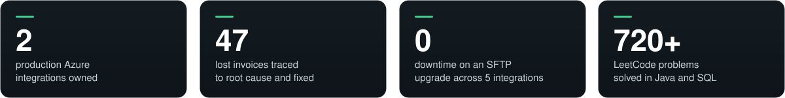
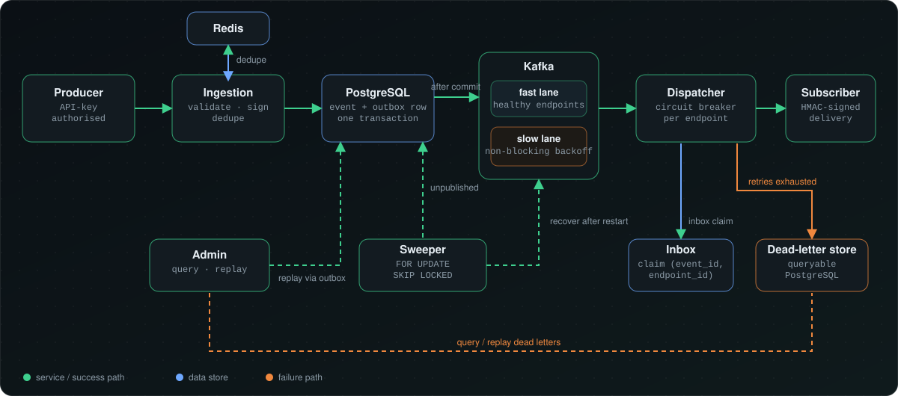

 

**I build event-driven backend systems and make them fail safely.** 
Nearly 2 years at Accenture running production Azure integrations (C#, .NET 8). Chennai, India.

 

 

## About

Since November 2024 I have worked at Accenture on two production event-driven integrations for a grocery-retail client. One delivers customer events to a data lake. The other delivers order documents to SAP S/4HANA. I own implementation, releases and production support, and most of what I know about distributed systems comes from debugging them in production.

Outside work I build a Java and Spring Boot platform to study the same problems in depth: delivery guarantees, deduplication, failure isolation and recovery.

 

## Production work

*C# / .NET 8 on Azure, for a grocery-retail client.*

<b>Case study: 47 lost invoices</b>

 

| | |
|:--|:--|
| **Problem** | 47 invoices went missing in the pipeline. |
| **Cause** | Blob filenames collided when two invoices were written in the same millisecond, so one overwrote the other. |
| **Fix** | Unique per-invoice filenames, plus concurrency limits aligned with what the receiver can handle. |
| **Verified** | Validated with 5,002 files and zero overwrites. |

<b>Case study: SFTP security upgrade with zero downtime</b>

 

| | |
|:--|:--|
| **Scope** | Four Function Apps and five integrations. |
| **Approach** | Configurable host-key prioritisation. |
| **Coordination** | I coordinated QA validation with the partner before cutover. |
| **Verified** | Cutover completed with zero downtime. |

**Also shipped**

- **Per-store assortment delivery.** Replaced a splitter/timer pipeline with a Service Bus-triggered Azure Function. SHA-256 content-hashed blob markers keep retries idempotent, and Polly handles backoff.
- **Alerting as code.** KQL alert rules deployed through ARM across three environments, routed to source-system owners, with knowledge-transfer sessions on the triage workflow.
- **Duplicate-detection tool.** A .NET tool that normalises XML before hashing and flags repeated transaction and handling-unit IDs across Blob Storage during production investigations.
- **Internal blob tooling.** Console tools for date-range counts, cross-container comparison, duplicate detection and Service Bus claim-check message generation.

 

## Flagship project: Reliable Webhook Delivery Platform

A personal project in **Java 17 and Spring Boot 3.2**, built to explore what reliable delivery takes when processes crash, endpoints fail and brokers redeliver. Three services: ingestion, dispatcher and admin.

 

| Decision | Why |
|:--|:--|
| **Transactional outbox with a sweeper** | The event and its outbox row commit together. An after-commit fast path publishes immediately. A `FOR UPDATE SKIP LOCKED` sweeper recovers anything left unpublished after a restart. |
| **Two layers of deduplication** | Redis rejects duplicates at ingestion. A PostgreSQL inbox claim on unique `(event_id, endpoint_id)` with `ON CONFLICT DO NOTHING` absorbs Kafka redeliveries. |
| **Fast and slow Kafka lanes** | Failing endpoints move to the slow lane with non-blocking backoff, so they cannot hold up healthy ones. Per-endpoint circuit breakers add further isolation. The cost is best-effort ordering instead of strict FIFO. |
| **Queryable dead-letter store** | Failed deliveries can be inspected in PostgreSQL and replayed through the outbox, so replay follows the same safe path as new events. |
| **Secure by default** | HMAC-SHA256 payload signing, API-key authorisation and SSRF validation of resolved IPs. |
| **Layered tests** | Unit, persistence, service, web and end-to-end tests using Testcontainers and WireMock. |

 

## Other projects

<table>
<tr>
<td width="33%" valign="top">

**Blog-Zone** 
Blogging platform built on a custom Spring Security filter chain with role-based access.  
Spring Boot · Spring Security · JPA/Hibernate · MySQL · AJAX

</td>
<td width="33%" valign="top">

**WeatherSpot** 
Weather service that wraps external weather APIs behind a Spring Boot backend.  
Spring Boot · Thymeleaf · Docker

</td>
<td width="33%" valign="top">

**PushNPull** 
API testing tool with custom headers, Basic and Bearer auth, and request history.  
Node.js · Express · JavaScript

</td>
</tr>
</table>

 

## Stack

**Used in production** (C# / .NET 8 on Azure)

Azure Functions · Service Bus · Blob and Table Storage · API Management · Application Insights · ARM · Azure DevOps · OAuth2/JWT · Polly · xUnit · Moq · SQL

**Projects and training** (Java and Spring Boot)

Spring Security · Spring Data JPA · Hibernate · Resilience4j · Testcontainers · WireMock · JUnit 5 · Maven

**Fundamentals:** data structures and algorithms, operating systems, computer networks, and NASM x86 assembly.

 

## Background

- **Accenture**, Software Engineer (since Nov 2024). Completed the three-month Cloud-Native Microservices residency covering Java, Spring Boot and Docker.
- **Education:** B.E. Computer Science, SNS College of Engineering, 2024.
- **Problem solving:** 720+ LeetCode problems in Java and SQL.
- **Mentoring:** one of three senior mentors in a college coding bootcamp, teaching Java, OOP and DSA.

 

**Open to backend and SDE roles at product companies.**

